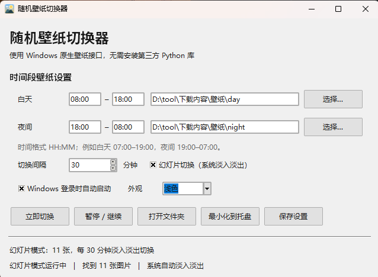

# 随机壁纸切换器 WallpaperSwitcher

一个 Windows 托盘小工具：按**时段（白天 / 夜间，或自定义多时段）**自动从指定文件夹随机切换桌面壁纸，支持 Windows 原生**幻灯片淡入淡出**、开机自启、深色主题。**单文件、零第三方依赖**，只用 Python 标准库 + ctypes 直调 Win32 API。

Random desktop wallpaper switcher for Windows — day/night (or custom multi-) schedules, native slideshow cross-fade, tray icon, startup link, dark mode. One file, no third-party dependencies (stdlib + ctypes only).


## 版本 Versions

| 版本 | 源文件 | 状态 |
|---|---|---|
| **v7.1（当前）** | `wallpaper_switcher_v7.py` + `wallpaper_switcher_v7.spec` | 最新，见 [Releases](../../releases) |
| v6（初版） | `wallpaper_switcher.py` + `wallpaper_switcher.spec` | 归档保留，仅白天/夜间两时段；`tests/` 针对此模块 |

## 功能 Features（v7.1）

- ⏰ **多时段壁纸**：`schedules` 列表，每段绑定名称/起止时间/文件夹/启停；支持跨午夜（如夜间 19:00–07:00）；无匹配时段回退首个启用段；禁用某段即该时段不切换；保存前校验时间格式
- 🔀 **随机切换**：洗牌袋算法，一轮内不重复；`last_used` 持久化，重启后不会重复上一张；间隔可调 1 分钟 ~ 7 天
- 📁 **递归扫描**：可选递归包含子文件夹（深度上限 + 后台线程扫描，网络盘/占位符目录不冻结 UI）
- 🎞️ **幻灯片模式**：接入 Windows `IDesktopWallpaper` 原生引擎，切换带系统级淡入淡出；WebP 单图先走原生接口再回退 SPI
- 🌙 **深浅主题**：跟随系统 / 浅色 / 深色三档，监听 `WM_SETTINGCHANGE` **实时刷新**，标题栏 DWM 沉浸深色；切换主题只换皮肤，不落盘、不重建自启
- 🧊 **软件外观自定义**：`ttk.Notebook` 卡片式四页（基本设置 / 时段与文件夹 / 软件外观 / 关于）；窗口背景 **默认 / 毛玻璃（透出壁纸）**；强调色 6 色预设色板（蓝/紫/青/绿/橙/红）
- 🖥️ **多显示器**：启动声明 DPI 感知，拦截 `WM_DPICHANGED` 按新 DPI 重算缩放与全部字号，跨屏拖动观感一致
- 📌 **系统托盘**：纯 ctypes 手写托盘图标与右键菜单；图标跟随 UI 主题，按 `SM_CXSMICON` 真实像素加载（高分屏不发虚）；Explorer 重启后自动重挂，添加失败延迟重试
- 🚀 **开机自启**：创建当前用户"启动"文件夹快捷方式（非注册表 Run，无需管理员权限）；exe 移动位置后自愈重写 `.lnk`
- **单实例**：Mutex 保证只跑一个；重复启动唤起已有窗口，并携带"是否后台"意图
- 💾 **原子写配置**：`%APPDATA%\WallpaperSwitcher\config.json`，写临时文件再替换，不怕中途断电
- 📋 **日志可观测**：滚动日志写入 `%APPDATA%\WallpaperSwitcher\app.log`，UI 与托盘均有"打开日志"；心跳/事件循环异常不再静默吞掉
- ❤️ **即时生效与自愈**：保存后 `next_switch=0` 立刻切换；扫描锁 `try/finally` + 超时强制复位；心跳超时主动自愈

> 初版 v6 的全部能力（时段壁纸、洗牌袋随机、幻灯片、托盘、开机自启、单实例、原子写配置）在 v7.1 均保留。

## 截图 Screenshots

> 

## 快速开始 Quick Start

### 方式一：下载预编译版（推荐）

到 [Releases](../../releases) 下载 `WallpaperSwitcherTrayV7-win64.zip`，解压后运行 `WallpaperSwitcherTrayV7\WallpaperSwitcherTrayV7.exe`。

> - 构建产物是 **onedir**（含 `_internal\`），整个文件夹一起分发，不能只拷 exe。
> - 首次运行若被 Windows SmartScreen 拦截，点"仍要运行"即可（程序未做代码签名）。

### 方式二：源码运行

需要 Python 3.12+ 且自带 tkinter（官方 Windows 安装包默认包含）：

```bash
python wallpaper_switcher_v7.py                 # 显示窗口启动
python wallpaper_switcher_v7.py --background    # 静默进托盘
```

## 从源码构建 Build from source

```bash
pip install -r requirements-build.txt           # 只有 pyinstaller
pyinstaller wallpaper_switcher_v7.spec --noconfirm
# 产物在 dist/WallpaperSwitcherTrayV7/
```

`wallpaper_switcher_v7.spec` 内置两轮已冒烟验证的瘦身：源码不再 import `random`/`hashlib`（改用 `os.urandom`），依赖图不再拉入约 5.6MB 的 libcrypto；并裁剪打包内 Tcl/Tk 的 locale/时区/多余编码数据（约 4.3MB → 0.9MB）。**请勿随意加激进 excludes** —— stdlib 相互引用（pathlib → urllib.parse → ipaddress）的坑只会在冻结后的 exe 运行时暴露。

图标 `icon_day.ico` / `icon_night.ico` 需与源文件同目录（spec 以此为相对路径）。

## 配置与日志 Files

| 路径 | 内容 |
|---|---|
| `%APPDATA%\WallpaperSwitcher\config.json` | 设置：时段列表、间隔、主题、强调色、背景模式、`last_used` 等 |
| `%APPDATA%\WallpaperSwitcher\app.log` | 滚动日志：运行异常、COM 调用 HRESULT、托盘/扫描状态 |

旧配置自动迁移：v6 的 `day_folder`/`night_folder` → `schedules`；已移除的 solid/gradient/image 背景 → `default`；不在色板内的自定义强调色 → 默认蓝。启动即可用，无需手动清理。

## 开发 Development

```bash
python -m py_compile wallpaper_switcher.py      # 语法检查（v6）
python -m py_compile wallpaper_switcher_v7.py   # 语法检查（v7.1）
python tests/test_logic.py                      # 纯逻辑单测（洗牌袋/时间解析/原子写配置）
python tests/test_tray.py                       # 托盘创建回归测试（需真实桌面会话）
python tests/test_theme.py                      # 主题引擎 GUI 测试
```

> `tests/` 目前 import 的是 v6 模块 `wallpaper_switcher.py`；v7.1 的回归以 `CHANGELOG.md` 记录的实机验证清单为准。

线程模型：托盘线程与扫描线程都只通过 `queue.Queue` 与 tk 主线程通信，不跨线程碰 UI。

## 实现要点 How it works

| 能力 | 实现 |
|---|---|
| 设置壁纸（单张） | `user32.SystemParametersInfoW(SPI_SETDESKWALLPAPER)` |
| 幻灯片（淡入淡出）/ WebP | `IDesktopWallpaper` COM（vtable 直调，ctypes 手写）+ `SHCreateShellItemArrayFromIDLists`；失败落日志（含 HRESULT）并降级 SPI |
| 托盘图标 | `Shell_NotifyIconW` + 隐藏消息窗口（`RegisterClassExW`/`CreateWindowExW`），独立线程消息循环；`TaskbarCreated` 重建 |
| 毛玻璃背景 | `SetWindowCompositionAttribute`（Acrylic）；`WM_ENTERSIZEMOVE` 期间临时降级 BlurBehind 规避拖动黑闪 |
| 主题实时跟随 | 子类化 tk 顶层窗口，监听 `WM_SETTINGCHANGE`（ImmersiveColorSet） |
| 开机自启 | PowerShell `WScript.Shell` 生成 `.lnk`（命令 base64 编码，防中文/空格路径损坏） |
| 单实例 | `CreateMutexW` + `ERROR_ALREADY_EXISTS`；重复启动用 `RegisterWindowMessageW` 广播唤起 |
| 调度 | tkinter `after()` 1 秒心跳链，异常记日志并保证重新排程，不会静默停摆 |
| 随机数 | `os.urandom`（不 import `random`，避免打包拖进 5.6MB 的 OpenSSL） |

## 已知限制 Known limitations

- 仅支持 Windows（依赖 Win32 API）；RDP 远程会话下幻灯片模式被系统禁用，自动回退单张切换
- 多显示器统一设一张壁纸（未做每屏独立）
- 图片格式：JPG / JPEG / PNG / BMP / WEBP（WebP 单图依赖系统接受 `IDesktopWallpaper.SetWallpaper`，否则提示改用幻灯片）
- `IDesktopWallpaper` 槽位号为手写 vtable（为零依赖不引入 `comtypes`），异常保护已加、失败落日志
- 未做代码签名（首次运行有 SmartScreen 提示）

## 致谢 Credits

图标由脚本生成（`assets/` 内 ico 为自绘日/夜主题）。

## 许可 License

[MIT](LICENSE)
